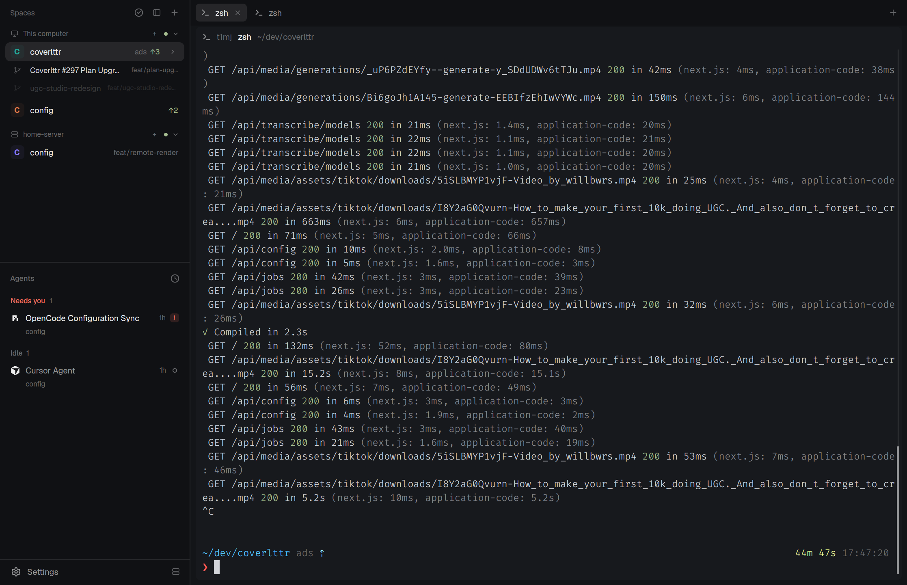

# Herdr T3 Worktrees

A Herdr window organized around git worktrees and an attention inbox. The left sidebar lists spaces with their linked worktrees nested under them, plus an agents list whose rows show the agent's name and its workspace; toggle the same slot to an Inbox of agents that still need you, with Working and Settled shelves. Terminals are framed cards with compact headers and hover buttons, a small brand bar and footer bookend the sidebar, and a top popup picks a tab to jump to.

## What you see

- **Sidebar, left, 256px** (min 208, max 480; `chrome` background, not drag-resizable):
  - A **40px brand bar** (`layout-controls`): the app mark and name, Settings, Add machine, the sidebar/inbox toggle and New space buttons, with a sidebar toggle at its right edge. It is the window's drag handle and makes room for macOS traffic lights (`[16, 13]` in the layout root).
  - A **stack** with two views:
    - **Lists**: a Spaces block (`spaces-with-worktrees`) above an Agents block (`agents-list`), each taking half the height with a 90px minimum.
      - Spaces rows show a colored initial avatar, the space name, its branch, status marks and an agent count. A repo with linked worktrees has a chevron: `›` reveals every worktree, `⌄` restores the default filter. Closed worktree rows are ghosted (12px, 30% opacity, ↳ prefix); open ones are 12px at 90% and always visible.
      - Agents rows are two lines: a state glyph plus the session title, then the program icon, agent name, workspace and worktree. `working` is a braille spinner; done `✓`, idle `○`, blocked `×`, unknown `·`. Pins and custom sorts are available on hover.
    - **Inbox** (`t3-inbox`, with `props.newMenu: "t3-new-menu"`): cards for agents that need attention, newest first, each with the agent's avatar, name, what it is doing, elapsed time and per-card actions (Pin, Settle, focus, close). Below them a **Working** shelf (folded by default, shows the focused agent) and a **Settled** tail (first 10, then 25 at a time). Its top row has a space-scope filter, Search, New space and New tab. Times read `just now`, `9m`, `2h` — never "ago".
  - A **41px footer** (`layout-controls` with `props.footer: true`): update indicator and footer actions.
- **Work column, right**:
  - A **40px tab bar** (`t3-tabs`): tabs as rounded pills with the program icon, session title, zoom `Z` and a status mark (spinner, `!`, done dot). Clicking a pill selects it; double-click renames; right-click opens the shipped `menu`; dragging reorders; the mouse wheel cycles tabs. A `+` button adds a tab. On Windows, minimize/maximize/close buttons use the mod's own SVG icons. When the sidebar is hidden, a toggle with agent status counts appears here.
  - **Terminals** as cards: 8px gap, radius 8, a 2px border in `background`, with a **28px header always revealed on top** (`t3-pane`): program icon, terminal address, agent/session name, `~`-shortened folder, a status mark, and on hover four 26px buttons to split right, split down, zoom and close the pane. Clicking the header focuses the pane.
  - A **hidden right panel** (368px, min 280, max 900) holding a Files / Changes stack; opened from the tab bar.
  - A 6px bottom inset and a hidden 28px `workspace-status` bar.
- The root hides the system title bar (`titlebar: "none"`), paints `canvas`, sets `terminal_opacity: 0` and `terminal_padding: [8, 0]`. Notifications use `t3-toast`: flat content (level icon, title, body, optional action) inside Herdr's own overlay chrome, not a second pill.

## How it behaves

- **Status is shared language.** Every list, tab and header reads the same agent state: `working` spins, `blocked` shows a `!` badge, `done` a dot, idle is dim. Sub-agent states fold into their parent with `name.js` / `tree.js`; in the Inbox and tabs a settled agent's `done` does not count as news, but new work or a stuck child unsettles it.
- **Spaces and worktrees.** `hc machine ls` adds connected machines (temporary ones are skipped) and `exec("git", …)` reads each repo's branch, status and `git worktree list`. Link checkouts nest under their parent space; closed ones appear only when dirty or when an agent is working in them. Click selects the space, or opens a new one for a ghost worktree; rows can be dragged to reorder. Only primary spaces consume `ctrl-1…9`; worktree rows stay clickable but unnumbered.
- **Agents.** `agents-list` keeps a per-agent state clock in `localStorage` and publishes it as shared `agents.changed` so the picker shows the same age. `alt-1…9` focuses the Nth agent in the visible list order. `exec("git", ["rev-parse", …])` supplies the workspace/worktree line.
- **Inbox.** State changes are tracked with a 2s grace so a quick stop does not move a card twice. `ctrl-shift-s` settles the focused agent (or un-settles a settled one, moving to the next card). Settle writes `settled=<ms>:<turn>` on the terminal with `hc label`, so it survives restarts and every mod sees it. Rows can be dragged between Pinned / Active / Settled; Esc returns the keyboard to the pane that had it. Search opens `t3-picker`; New tab opens `t3-new-menu`.
- **Picker.** `ctrl-p` / `ctrl-alt-p` opens a 640px-wide popup at 80% height. Spaces with agents that need you sort first; quiet spaces fold into "earlier". Type to filter, arrows plus Enter to go, `ctrl+d` closes the selected tab, Esc leaves. Final rows create a tab here, or a space on this / each connected machine.
- **Brand bar and side pane.** `ctrl-shift-b` switches Lists ↔ Inbox; `ctrl-\` shows or hides a right shell pane, using `terminal.keep` / `terminal.park` so the process survives hiding. `ctrl-b` toggles the sidebar. `ctrl-alt-up` / `ctrl-alt-down` scroll the focused terminal to its start/end and forward the same key to app-owned history (e.g. Pi) with native `send:`, queuing the host scroll afterward.
- **Toasts** render the level icon, title, body and optional action; clicking the action runs its named command.

## Built from

- **Layout**: `layouts/herdr-t3-worktrees.json`, a `row` with a `column` sidebar and a `column` work area. The sidebar holds the `layout-controls` brand block (40px, `window_drag`), a `stack` (`sidebar-lists`) whose `lists` child contains the Spaces and Agents blocks and whose `inbox` child holds `t3-inbox`, then the footer block (41px). The work area holds the `t3-tabs` block (40px), a `row` with the `tab: "active"` block (whose `pane.header` is `t3-pane`) and the hidden Files/Changes panel, a 6px inset and the hidden status block. The root sets `"toast": "t3-toast"`; delete that field to keep Herdr's shipped toast.
- **Mods** (all with `place: "none"`): `layout-controls` (brand bar + footer + side-pane and edge-scroll commands), `spaces-with-worktrees` (Spaces clone), `agents-list` (Agents clone), `t3-inbox`, `t3-tabs` (Tabs clone), `t3-pane` (pane header clone), `t3-new-menu` (New menu clone, 520×420 top popup), `t3-picker` (Picker clone, 640px / 80% top popup), `t3-toast` (Toast clone). Cloned mods keep `cloned_from` metadata from app 0.1.10/0.1.11; the files were checked against 0.1.13.
- **Shipped mods used by path**: `workspace-chrome` icons (branch, check, chevrons, folder, pin, search, server, sidebar, plus, spinner, layers, circle-check, folder-plus), `pane/close.svg`, plus the shipped `files`, `changes`, `workspace-status` and `menu` mods. These are not bundled.
- **Herdr API**: `agents()`, `terminals()`, `panes()`, `spaces()`, `machines()`, `focused()`, `layout()`, `window()`, `settings()`, `theme()`, `shared()`/`setShared()`, `run()`, `hc()`, `exec()`, `watchFolder()`, `notify()`, `nextCommand()`, `openOverlay()`/`closeOverlay()`, `props()`, `setAgentOrder()`, plus `localStorage` and `cx.timer`/`cx.spawn`.
- **Commands run**: `space.new/select/move`, `tab.new/select/close/rename/move`, `pane.split/focus/close/zoom`, `terminal.keep/park/peek/focus/scroll/close`, `agent.focus`, `layout.select/toggle/resize`, `mod.open`, `window.minimize/maximize/close`, `app.settings`, `app.check_updates`, `layout.switch`, `tab.move`, and the mods' own `agents-list.select`, `spaces-with-worktrees.select`, `layout-controls.side/sidebar/top/bottom`, `t3-inbox.settle`.
- **Art**: SVGs inside their mod folders (`t3-pane/` split/zoom/close, `t3-tabs/` Windows buttons, `t3-inbox/` undo and filter, `t3-toast/` level icons), plus `layouts/herdr-t3-worktrees.svg` for the in-app layout thumbnail. Fonts and colors come from the active theme; the layout sets no theme of its own.
- **Network / programs / files**: no `fetch` or network access. `exec` runs `git` (status, rev-parse, worktree list, only read-only flags) in the spaces' folders; `hc` runs `machine ls --json` and `label` (to write the `settled=` label). Mods read and write their own `localStorage` keys (`changed`, `pins`, `scope`, `open`, `working-open`, `machines.folded`, `herdr.side`) and shared keys (`agents.changed`, `agents.pins`, `space.colors`, `sidebar.width`, `workspace.panels`).

## Watch out

- Every bundled mod was renamed so it cannot replace a shipped mod: `picker` → `t3-picker`, `toast` → `t3-toast`, and the clones already had their own names. If you rename again, change the folder, the `mod` references in the layout, any `mods/<name>/…` asset paths inside `main.js`, the root `"toast"` field, and the command names in `keys.json`. `t3-inbox`'s Search button calls `mod.open:t3-picker` directly.
- `keys.json` here is a **snippet to merge** into the person's own file, not a replacement. The `layout:herdr-t3-worktrees` section only applies while that exact layout name is shown — if the layout file is renamed, update the section name. `ctrl-1…9` in that section intentionally replaces the default `space.select:1…9` while this layout is active; `alt-1…9` and the global `ctrl-\` apply everywhere. Ask before replacing a key the person already uses.
- `herdr-app check` passes for all nine mods on app 0.1.13, but it only checks initial render and eager native elements: test the picker, inbox shelves, side pane, drag-to-settle and toasts in a live window. `check-inbox.cjs` and `check-pane.cjs` inside two mods are local unit-test harnesses, not runtime requirements.
- The Inbox's Settled shelf opens on 10 rows and grows by 25; the stop grace is 2s; the picker popup is fixed at 640px and 80% of window height, so it can overflow a small window. Worktree row styling is tuned for a 256px sidebar and the narrow compact rail is narrower still.
- `watchFolder()` follows each repo with linked worktrees; `git` must be on PATH on the local machine and on any remote machine whose worktrees you view. `hc label` writes a terminal label, not a file.
- `cloned_from` records old app versions because these are local clones. The shipped `herdr.d.ts` / `gpui-kit.d.ts` are rewritten by the app on every start — the copies inside mod folders are editor aids only and can be dropped.
- The layout preview path points at `layouts/herdr-t3-worktrees.svg`; the gallery's `preview.png` at the folder root is a separate screenshot (`herdr-app shot`). Leave both.

## Done when

- `herdr-app check mods/<name>` passes for all nine mod folders on app 0.1.13.
- Adding the folder puts "Herdr T3 Worktrees" next to the person's layouts; `ctrl-shift-l` (or `layout.switch herdr-t3-worktrees`) shows it and the settings screen shows its thumbnail, without touching their own layout.
- `ctrl-1…9` selects primary spaces; a repo with linked worktrees has a chevron that reveals clean ones, and ghost rows open a space in their folder.
- `alt-1…9` focuses agents in the visible list order; a blocked agent shows `!`, a working one spins, and a sub-agent's state shows on its parent.
- `ctrl-shift-b` shows the Inbox; `ctrl-shift-s` settles or un-settles the focused agent and a new turn brings it back.
- `ctrl-p` opens the picker, filtering finds a tab, Enter switches to it and `ctrl+d` closes the selected tab.
- `ctrl-\` hides and restores the right shell pane with its process alive; `ctrl-alt-up` / `ctrl-alt-down` scroll the terminal and its program history.
- A `notify()` shows the custom toast, and its action button runs the command named in the notification.
- The merged `keys.json` keeps all of the person's existing bindings and adds only the ones above.
